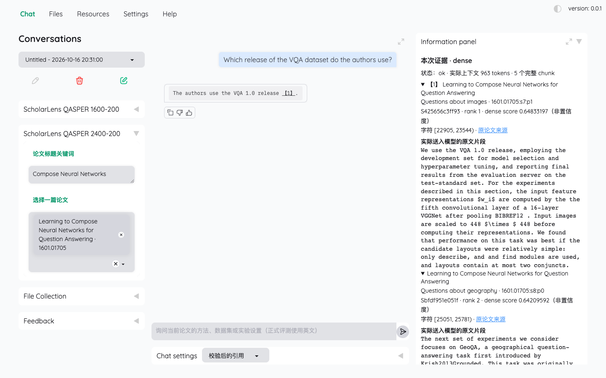
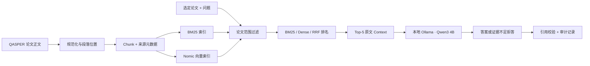

# ScholarLens · 研知

**让论文问答回到原文。** ScholarLens 是面向 AI 论文阅读的本地 RAG 助手：选定一篇论文，询问方法、数据集或实验设置，查看回答引用的原文段落，并追踪检索、上下文和生成过程。

`本地运行` · `论文范围检索` · `可定位引用` · `冻结评测`

[快速开始](#快速开始) · [系统如何工作](#系统如何工作) · [评测结果](#评测结果) · [复现与边界](#复现与边界)



<sub>真实本地截图：公开 QASPER 论文 *Learning to Compose Neural Networks for Question Answering* 的演示问答。截图中的成功示例不计入正式评测成绩。</sub>

## 为什么做这个项目

读论文时，生成式回答很容易省略条件、混淆实验设置，或者给出无法核对的引用。ScholarLens 把问题限制在**用户选定的一篇论文**，把回答中的引用连回真实送入模型的原文，并保留失败发生在“召回、上下文选择、生成还是引用校验”哪一步的记录。

- **查得到：** 对 1,584 篇可用 QASPER 论文建库；在选定论文内提供 BM25、Dense、RRF Hybrid 三种检索方式。
- **核得对：** 展示论文、章节、段落、规范化字符区间及原文片段；引用必须指向本次 context 中的证据。
- **能复盘：** 保存实际 query、排名、context、prompt、模型响应和引用检查；用冻结的 Dev/Test 题集比较方法，并保留失败案例。

当前是 Apple Silicon Mac 上验证的**单论文范围研究原型**，不支持跨论文自动综述，也不是生产服务。

## 系统如何工作



正文与 QASPER 原有的问题、答案、证据标注**分开导出**，标注不进入检索索引。Gold evidence 绑定原文位置，不绑定某次切分产生的 chunk ID。两种实验索引为 `1600/200`、`2400/200` 字符切分；最终配置 `2400/200 + Dense` 由 Dev 选择。代码数据流见 [V2 技术说明](v2/README.md)。

## 评测结果

在同一 `2400/200` 索引上，冻结 Test 的 300 道检索题中有 240 道可回答题；下表的召回和 MRR 只以这 240 题计分。EvidenceRecall@5 衡量 Top-5 文本对标注原文证据 span 的覆盖，**不是答案正确率**。

| Test 检索方法 | EvidenceRecall@5 ↑ | MRR@10 ↑ |
|---|---:|---:|
| BM25 | 0.4654 | 0.3649 |
| Dense | **0.6290** | **0.4965** |
| RRF Hybrid | 0.5901 | 0.4878 |

所选 Dense 与本地 `qwen3:4b-instruct-2507-q4_K_M` 在预先冻结的 **100 题生成子集**上取得 Answer F1 **0.3347**、Evidence F1 **0.3790**；其中仍有 **22/80** 道可回答题错误拒答、**9/100** 次输出截断。无答案题正确拒答 **17/20**。这些数字说明系统仍有明显的检索与生成缺陷，不能把可定位引用等同于事实正确。

[正式 Test 报告：分母、配置与逐题记录](v2/reports/test.md) · [Dev 切分/方法对照](v2/reports/dev-retrieval.md) · [三类真实失败案例](v2/reports/t9-failures.md)

## 快速开始

已验证环境：MacBook M5 / 16 GB、Python 3.10.22、Ollama 0.15.6。需要先准备本地 QASPER 数据、索引、锁定依赖以及 `nomic-embed-text`、`qwen3:4b-instruct-2507-q4_K_M` 模型；这些大文件**不包含在仓库中**。新机器请先按 [环境、数据与建库说明](v2/README.scholar.md)准备，以下是**已准备好环境**的启动命令。

1. 打开 Ollama 桌面应用。
2. 在仓库根目录运行：

```sh
cd v2
SCHOLAR_CONFIG="$PWD/configs/selected_config.json" bash scripts/start_app.sh
```

3. 打开 `http://127.0.0.1:7860/`，在 **ScholarLens QASPER 2400-200** 集合中只选一篇论文。可搜索 `Compose Neural Networks`，选择 `1601.01705`，提问 `Which release of the VQA dataset do the authors use?`，再点击引用查看原文。这是演示，不是正式成绩。

命令行检索、问答、数据准备、建库和评测入口见 [V2 技术说明](v2/README.md)。

## 复现与边界

- 数据来自 [QASPER 官方数据集](https://huggingface.co/datasets/allenai/qasper)。固定版本和 SHA-256 在[配置](v2/configs/selected_config.json)中；全文、模型、数据库、索引、完整题集和逐题运行产物不提交 Git。仓库提供代码、冻结配置、测试与汇总报告。
- Dev 用于选配置；冻结 Test 只做一次正式评测，不用 Test 调参。30 道 Dev 题的语义检查由助手辅助完成，**不是独立人类 gold 审查**。本机 V2 回归测试 187 项、旧 V0 测试 11 项通过；正式运行产物通过离线复算。
- 应用复用 [Kotaemon](https://github.com/Cinnamon/kotaemon) 的 Gradio、存储和模型接入组件；本项目的改造集中在论文数据/证据位置、论文范围三路检索、问答引用审计与冻结评测。[上游版本、改动边界与许可证](v2/UPSTREAM.md)如实保留，不将复用组件表述为从零自研。
- 结果只适用于当前英文 QASPER 小规模题集和单机 4B 模型。Hybrid 在本次 Test 的 @5 低于 Dense；不能据此宣称某一种方法普遍最好。截图和演示题仅展示功能，不替代正式评测。
