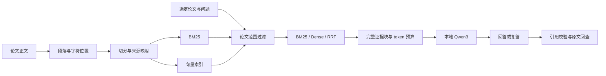

# ScholarLens · 研知

本地论文问答工具。选择一篇论文，询问方法、数据集或实验设置，再从回答中的引用回到原文。

[演示](#演示) · [主要改造](#主要改造) · [实验结果](#实验结果) · [运行](#运行) · [实现细节](docs/project/TECHNICAL.md)

## 演示


截图使用公开 QASPER 论文 *Learning to Compose Neural Networks for Question Answering*。左侧选择论文，中间提问，右侧查看实际送入模型的证据和原文位置。演示样例不计入正式实验成绩。

应用在 Apple M5 / 16 GB Mac 上运行，使用本地 Ollama 与 Qwen3 4B。语料包含 1,584 篇可用论文；每次查询只搜索选定的一篇，不做跨论文综述。

## 主要改造

项目基于 [Kotaemon](https://github.com/Cinnamon/kotaemon) 二次开发，复用 Gradio、文件集合与存储组件。新增实现集中在 `scholarlens/`：

| 问题 | 实现 | 代码入口 |
| --- | --- | --- |
| 切分方式改变后，如何继续核对同一条证据？ | 以论文、段落和规范化字符区间定位证据，不用 chunk ID 作为 gold | [数据处理](scholarlens/data.py)、[题集构建](scholarlens/dataset.py) |
| 如何避免混入其他论文或评测答案？ | 正文与标注分离，检索按 paper/file 范围过滤，网页和 CLI 共用检索适配层 | [索引](scholarlens/indexing.py)、[检索](scholarlens/retrieval.py) |
| 回答引用的文本是否真的给过模型？ | 完整块上下文预算、引用位置校验，保存实际输入与响应 | [上下文](scholarlens/context.py)、[问答](scholarlens/qa.py) |
| 如何分清检索问题与生成问题？ | 分别统计证据覆盖、排名与答案 F1，保存逐题结果并离线复算 | [指标](scholarlens/metrics.py)、[评测](scholarlens/evaluate.py) |

## 数据流



Dense 在选定论文的已存向量上精确打分，不是全库 ANN 搜索。最多 5 个完整块、4,500 context tokens 进入生成；审计记录保留检索排名、实际 context、prompt、模型响应和引用检查。

## 实验结果

基于 QASPER 构建 500 道检索题及 150 道生成子集。Dev 用于比较切分与检索方法；最终选择 `2400/200 + Dense` 后，在冻结 Test 上评测。

检索 Test 共 300 题，以下指标只统计其中 240 道可回答题，查询范围为单篇论文。EvidenceRecall@5 按完整原文证据段落覆盖计算，不是答案正确率。

| 方法 | EvidenceRecall@5 | MRR@10 |
| --- | ---: | ---: |
| BM25 | 0.4654 | 0.3649 |
| Dense | 0.6290 | 0.4965 |
| RRF Hybrid | 0.5901 | 0.4878 |

这次实验中，Hybrid 没有在 @5 上超过 Dense。因此应用采用 Dev 选定的 Dense，而不是因为融合方法更复杂就默认使用它。

100 题生成 Test 的 Answer F1 为 0.3347、Evidence F1 为 0.3790；无答案题正确拒答 17/20。仍有 22/80 道可回答题被错误拒答、9/100 次输出截断，说明检索到证据和模型正确使用证据是两个问题。

[完整结果与统计口径](reports/test.md) · [Dev 对照](reports/dev-retrieval.md) · [三个失败案例](reports/t9-failures.md)

## 运行

参考环境为 Python 3.10.22、Ollama 0.15.6，模型为 `nomic-embed-text` 和 `qwen3:4b-instruct-2507-q4_K_M`。依赖、模型、数据和索引准备见[本地运行指南](docs/project/LOCAL_SETUP.md)，仓库不包含这些运行产物。

环境准备好后，在仓库根目录启动：

```sh
SCHOLAR_CONFIG="$PWD/configs/selected_config.json" bash scripts/start_app.sh
```

访问 `http://127.0.0.1:7860/`，选择 **ScholarLens QASPER 2400-200** 集合和一篇论文。可搜索 `Compose Neural Networks`，选择 `1601.01705`，提问：

```text
Which release of the VQA dataset do the authors use?
```

检查答案引用对应的原文，而不只看回答文本。Ollama 服务需预先启动；不要重复启动占用相同端口的服务。

## 深入阅读

- [实现与设计取舍](docs/project/TECHNICAL.md)：索引、论文隔离、上下文、引用与指标。
- [安装与本地运行](docs/project/LOCAL_SETUP.md)：依赖、数据准备、建库和常见问题。
- [来源与复用范围](UPSTREAM.md)：Kotaemon、QASPER evaluator、许可及辅助开发说明。

当前版本只验证了英文 QASPER、单机模型和单论文检索，不保证答案事实正确，也没有生产服务性能结论。历史实验报告保留在 `reports/`，其中阶段编号用于对应当时的配置和记录。
