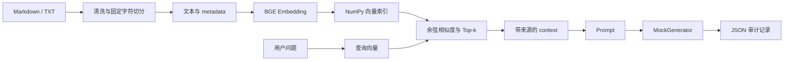

# Traceable RAG

[](https://github.com/snowstorm-121/traceable-rag/actions/workflows/tests.yml)

一个从零实现的本地可追溯 RAG 检索原型，覆盖文档切分、向量化、Top-k 检索、上下文组装、审计记录与自动化测试。

> A transparent local RAG baseline with traceable retrieval, audit logs, and reproducible tests.

## 项目亮点

- **透明实现：** 不依赖 LangChain、LlamaIndex 或向量数据库，核心数据流可以直接阅读和调试。
- **结果可追溯：** 每次查询保留来源、chunk id、相似度、context、Prompt 和生成器信息。
- **数据契约明确：** 强制校验 `embeddings.npy[i]` 与 `chunks.jsonl[i]` 的对应关系，发现错位立即停止。
- **行为可验证：** 使用标准库 unittest 覆盖文档处理、向量持久化、检索排序和端到端问答组装。

## 数据流



## Quick Start

```bash
python -m venv .venv
source .venv/bin/activate
python -m pip install -r requirements.txt
python build_index.py examples/sample_document.md
python ask.py "什么是可追溯检索？" --top-k 2
```

如果模型已经下载到本机缓存，可以在建库时增加 `--local-files-only`，完全离线加载模型。

## 示例结果

运行示例后，终端会展示查询向量 shape、全量得分 shape、Top-k 来源和分数，并将完整记录写入 `artifacts/queries/`。经过脱敏的真实输出见 [`examples/sample_query.json`](examples/sample_query.json)。

## 项目结构

```text
rag/                 文档处理、向量、检索和问答组装
build_index.py       离线建库入口
ask.py               查询与审计记录入口
examples/            可公开复现的示例语料和输出
tests/               自动化测试
```

## 关键设计

### 文本块与向量严格对齐

`chunks.jsonl` 的第 i 条记录必须对应 `embeddings.npy` 的第 i 行。查询前会检查二者数量；不一致时抛出错误，避免返回来源错位的结果。

### 中间结果完整保留

审计记录包含 query、Top-k、context、Prompt、mock answer 和 shape 信息，便于定位问题发生在切分、召回还是生成输入阶段。

### 依赖保持最小

项目只使用 sentence-transformers 生成向量，并用 NumPy 完成持久化和余弦检索，便于理解最小 RAG 链路。

## 测试

```bash
PYTHONPATH=. python -m unittest discover -s tests -v
```

测试使用 fake embedding model，不需要下载真实模型，覆盖文档规范化、overlap、metadata、向量读写、Top-k 排序、索引完整性和端到端审计记录。

## 已知限制

- 当前按 500 字符切分，overlap 为 80，尚未实现语义切分。
- 当前只有 dense vector retrieval，没有 hybrid search、rerank 或 query rewriting。
- `MockGenerator` 不调用真实 LLM，因此本项目是“检索与可追溯问答组装原型”，不是完整问答产品。
- 当前以 CPU 和单机文件为运行环境，没有提供线上服务。

## 后续方向

- 在独立评测集上比较不同切分和检索策略；
- 增加关键词混合检索与 rerank 对照实验；
- 在保持审计字段不变的前提下接入可替换的真实生成器。
